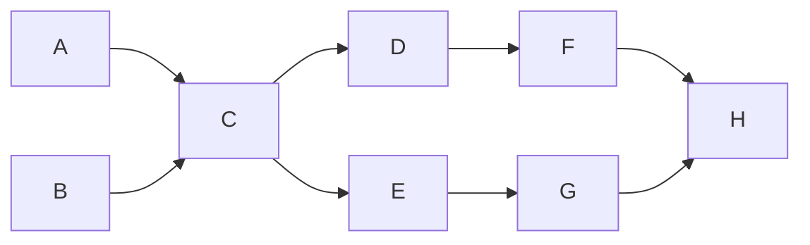

# examen-parcial-grupo-10

## Ejercicio 1: procesamiento de archivos

Aplicación Java sin dependencias externas. Requiere JDK 17 o superior.

### Compilar y ejecutar

Desde la carpeta del proyecto:

```bash
javac ejercicio-1.java
java Main
```

Sin argumentos se abre una ventana para indicar N, iniciar los procesos y consultar el avance y las métricas. El valor predeterminado es 1000000 líneas por archivo.

Para ejecutar directamente desde la consola con un N específico, pásalo como argumento:

```bash
java Main 1000
```

La ventana y la ejecución por consola ejecutan primero la versión serial y luego la paralela.

### Procesos

La aplicación ejecuta los procesos A-H en dos modos:

- **Serial:** ejecuta A, B, C, D, E, F, G y H en ese orden.
- **Paralelo:** A y B corren simultáneamente; C espera a ambos. D y E esperan a C y pueden correr simultáneamente. F espera a D, G espera a E y H espera a F y G.

### Vista del flujo paralelo



Cada proceso lee y escribe archivos de texto mediante `java.nio.file`, `BufferedReader` y `BufferedWriter`. Los archivos se guardan en `datos-ejercicio-1/` y se sobrescriben al ejecutar nuevamente:

| Proceso | Operación | Archivo generado |
| --- | --- | --- |
| A | Genera datos A | `datos_A.txt` |
| B | Genera datos B | `datos_B.txt` |
| C | Une A y B | `C_union.txt` |
| D | Convierte C a mayúsculas | `D_mayusculas.txt` |
| E | Filtra líneas de C que contienen `5` | `E_filtrado.txt` |
| F | Elimina líneas duplicadas consecutivas de D | `F_sin_duplicados.txt` |
| G | Cuenta líneas y palabras de E | `G_reporte.txt` |
| H | Une F y G | `H_resultado.txt` |

Al terminar se muestran el tiempo serial, el tiempo paralelo, el speedup y la eficiencia calculada con dos hilos.